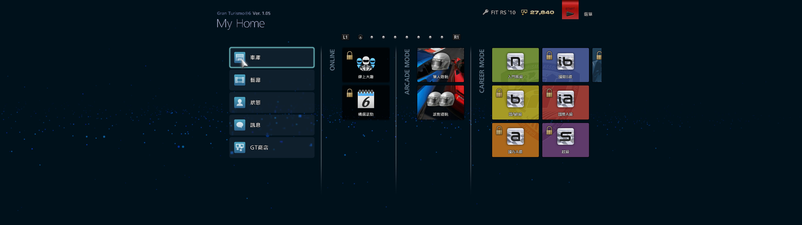
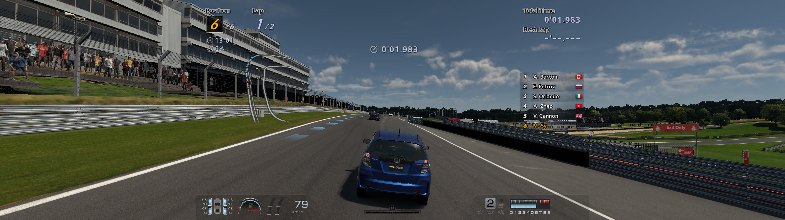

# Gran Turismo 6 RPCS3 Ultrawide 32:9

面向 RPCS3 上 **Gran Turismo 6 (BCAS25018)** 的真正 32:9 超宽屏补丁，不是简单的画面拉伸。

## 目标

- 显示/输出尺寸：`2560 × 720`
- 显示比例：32:9
- 游戏内部 3D 按 32:9 渲染
- 水平 FOV 真正变大
- 3D 比例保持正常，而不是把 16:9 内容横拉

## 工作原理

GT6 内部多处使用 `1.7777778f` 作为 16:9 长宽比常量。本补丁把其中 **16 个** 编译期常量从：

```text
1.7777778 -> 3.5555556
```

渲染理解为：

```text
GT6 内部按 32:9 3D FOV/近远/aspect 进行渲染
  -> RPCS3 渲染面
  -> GPU -> Stretch To Display Area
  -> 2560 x 720 输出
```

## 已验证版本

| 版本 | PPU hash |
| --- | --- |
| 1.00 | `PPU-dd7ec6f4719ae9938b2e76bed97232ffc9dbdda1` |
| 1.05 | `PPU-824c9dd3c8f7de8b5060ec99b06f474de274de35` |

说明：
- 两个版本的 `EMAIN.SELF` 常量坐标不同。
- 必须按运行的 `EMAIN` hash 选 patch，不能直接复用地址。
- patch 不能“通用地”写死在所有版本上，需要 port。

**两组地址的证据强度不同，请注意区分：**

| 版本 | 地址来源 | 证据强度 |
| --- | --- | --- |
| 1.00 | 对 `EMAIN.SELF`（亚版光盘版）反汇编得到：16 处 `1.7777778f` 常量、14 处代码引用，含 `PDIScene::CameraAspectAdapter`、`SimpleCamera` 构造等调用点 | 完整静态分析，可复现（`tools/` + `tools/xref16.txt`） |
| 1.05 | 按同一套特征在 1.05 `EMAIN` 上重新定位得到，依据是实机画面生效 | 实机验证通过，但仓库内未附 1.05 的反汇编原始输出 |

如果有人要复核 1.05 那组地址，流程见 `PATCH_BUILD_GUIDE.md`。

## 截图

全部为实机 RPCS3 输出（`Ver. 1.05`，Brands Hatch）。原始截图按下表**横向压缩**保存，这里已按 2 倍水平还原为真实 32:9：

```text
2560 × 1440  ->  5120 × 1440
1920 × 1080  ->  3840 × 1080
```

还原倍数是这样确认的：菜单页的圆形分页圆点、`L1`/`R1` 方形徽标，在 2 倍水平还原后恢复为正圆和正方形；若倍数不对，它们会变成明显的横椭圆或竖椭圆。原始 16:9 文件保留在 `screenshots/original-16x9/` 供核对。

| 文件 | 场景 | 还原后分辨率 |
| --- | --- | --- |
| `screenshots/01-myhome-ver1.05.jpg` | My Home 主菜单 | 5120 × 1440 |
| `screenshots/02-brands-hatch-chase.jpg` | 追尾视角 | 3840 × 1080 |
| `screenshots/03-brands-hatch-cockpit.jpg` | 车内视角 | 3840 × 1080 |
| `screenshots/04-brands-hatch-hood.jpg` | 车头视角 | 3840 × 1080 |
| `screenshots/05-brands-hatch-starting-grid.jpg` | Starting Grid | 3840 × 1080 |




判读要点：还原后车身、轮毂、仪表盘圆表、HUD 圆形图标均为正圆而非椭圆，说明是**水平 FOV 真的变宽**，不是把 16:9 内容横向拉宽。若是后者，2 倍还原后这些圆会变成明显的横椭圆。

缺少「未打补丁」的 baseline 截图，因此本目录目前只能证明「打补丁后比例正确」，不能直接证明「打补丁前后视野差多少」。

## 仓库目录

```text
gt6-rpcs3-ultrawide/
  README.md
  USAGE.md
  PATCH_BUILD_GUIDE.md
  LICENSE
  patch_config.example.yml
  patches/
    BCAS25018_patch.yml
  legacy/
    BCAS25018-32x9-test.yml
  screenshots/
    01-myhome-ver1.05.jpg
    02-brands-hatch-chase.jpg
    03-brands-hatch-cockpit.jpg
    04-brands-hatch-hood.jpg
    05-brands-hatch-starting-grid.jpg
    original-16x9/          （原始 16:9 压缩截图，供核对还原）
  tools/
    ...
```

## 使用前要求

- 每次只启用 **一个** patch。
- 切换 patch 前，必须完全退出游戏再重新启动 RPCS3。
- `Stretch To Display Area` 应当开启。
- 推荐使用固定机位截图对比，不建议以完整比赛作为验证证据。

## 已知限制

- 1.00 有已知 game-breaking bug。
- 1.05 不能跑全部 progression（需要视 save 生成而定）。
- HUD/2D 坐标可能需要单独 patch，当前以 3D horizontal FOV 为主。

## 文档

- `USAGE.md`：安装、设置、使用和故障排除
- `PATCH_BUILD_GUIDE.md`：从新版本 ELF 提取新 patch 的流程
- `patch_config.example.yml`：UI/配置选项示例
- `legacy/BCAS25018-32x9-test.yml`：实验数据和过渡证据
- `screenshots/`：实机 32:9 截图（已从 16:9 压缩还原）

---

MIT License，见 `LICENSE`。Attribution: gt6-uw (moon), 2026-10-28